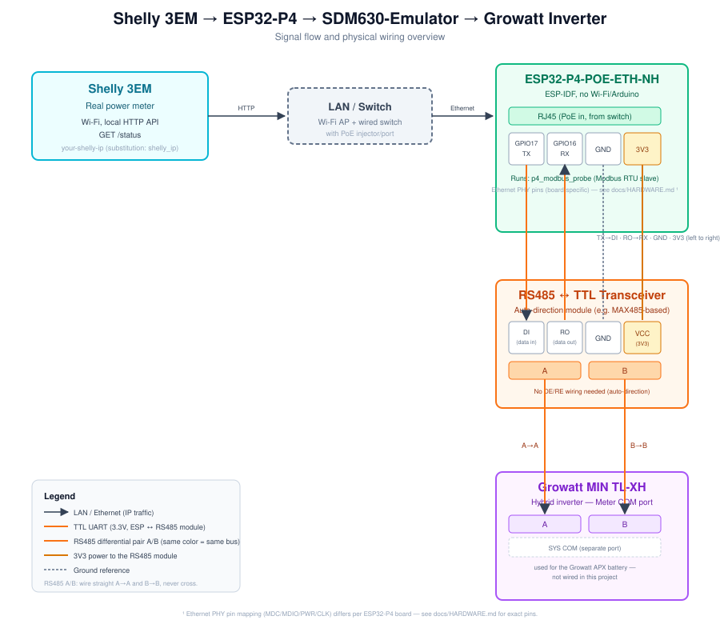

# Wiring



## Overview

```
[Shelly 3EM] --HTTP/WiFi--> [ESP32-P4-POE-ETH] --RS485--> [RS485 converter] --A/B--> [Growatt Inverter Meter-COM]
                                    |
                                  PoE Ethernet uplink to your network switch
```

The ESP32-P4 does two unrelated jobs:

1. Polls the real Shelly 3EM over HTTP (via Ethernet/your LAN) once a second.
2. Answers Modbus RTU "read input/holding register" requests from the
   inverter over RS485, pretending to be an Eastron SDM630 energy meter,
   using the live values fetched from the Shelly.

## Power

The board is powered entirely over PoE (802.3af) through the Ethernet cable.
No separate power supply is needed if your switch/injector provides PoE.

## UART ↔ RS485 wiring

The ESP32-P4's UART pins are TTL-level (3.3V), not RS485. A separate RS485
transceiver module sits between the ESP and the inverter's Modbus bus.

| ESP32-P4 pin | Signal | Connects to RS485 module |
|---|---|---|
| GPIO17 | UART TX | `DI` / `RXD` (module's RS485→controller input side labeling varies by module) |
| GPIO16 | UART RX | `RO` / `TXD` |
| GND | Ground | `GND` |

| RS485 module | Connects to |
|---|---|
| `A` | Inverter Modbus bus `A` |
| `B` | Inverter Modbus bus `B` |

**Module with DE/RE pins:** if your RS485 module exposes separate `DE`
(Driver Enable) and `RE` (Receiver Enable) pins rather than auto-direction
switching, this project's software does **not** toggle them — it assumes
an auto-direction module. Tie `DE` and `RE` together and to a pull level
that keeps the module in receive-by-default / auto-switch-on-send mode, per
your module's datasheet, or you will need to add direction control code.

## Modbus bus address

In the stock configuration, the device answers as Modbus slave address `2`
(`modbus_slave_id` substitution), matching the address the Growatt inverter
polls for its configured smart meter in this installation. **Confirm what
address your inverter actually expects** before relying on this — see
`docs/MODBUS-NOTES.md` for how to sniff and verify this on your own bus.

## Note on the Growatt APX battery

If you also have a Growatt APX battery attached to the same inverter: the
battery's BMS communication runs over the inverter's **separate "SYS COM"**
port, not the smart-meter/Modbus COM port this project taps into. The two
should not be on the same physical RS485 bus in a standard installation.
